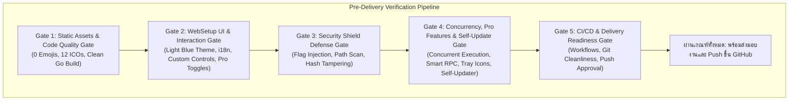

# Discord PTB Portable + Vencord WebSetup Suite (Security, Multi-Profile & Self-Updating Edition) Implementation Plan

> **For agentic workers:** REQUIRED SKILLS:
> 1. `superpowers:dispatching-parallel-agents`: มอบหมายงานให้ AI ตัวแยก (Subagents) ดำเนินงานคู่ขนานหลายตัวพร้อมกัน
> 2. `superpowers:subagent-driven-development`: บริหารจัดการงานตาม Task Breakdown
> 3. `superpowers:test-driven-development`: เขียนชุดทดสอบก่อนและระหว่างการพัฒนา
> 4. `superpowers:verification-before-completion`: ตรวจสอบผลการรันคำสั่งจริงก่อนยืนยันความสำเร็จทุกครั้ง
>
> Steps use checkbox (`- [ ]`) syntax for tracking.

## AI Skills & Parallel Subagents Work Allocation
- **Subagent A (Asset & Frontend Specialist):** รับผิดชอบ Task 1 (Icon Pipeline) และ Task 2 (Web UI HTML/CSS/JS โทนสว่าง ขาว-ฟ้าอ่อน โค้งมน ไร้อิโมจิ)
- **Subagent B (Discord Core & CI/CD Specialist):** รับผิดชอบ Task 6 (อัปเกรด Discord PTB 1.0.1231, Vencord Integration, GitHub Actions Auto-Pipeline)
- **Parent Agent & Subagent C (Security & Backend Engine Specialist):** รับผิดชอบ Task 3, 4, 5 (Security Shield, Self-Updating Launcher, Multi-Profile Engine, WebSetup Go Backend)
- **QA Verification Agent:** รับผิดชอบ Task 7 (สคริปต์ตรวจสอบก่อนส่งมอบงาน และ Acceptance Gates)

**Goal:** อัปเกรด Discord PTB สู่เวอร์ชันล่าสุด (1.0.1231), เพิ่มระบบเช็กและอัปเดตอัตโนมัติบน GitHub Actions เมื่อ Discord หรือ Vencord มีเวอร์ชันใหม่, ผสาน Client Mod Vencord, สร้าง WebSetup Installer ขนาดเล็กด้วยภาษา Go หน้าต่างทรงโค้งมน โทนสว่าง ขาว-ฟ้าอ่อน คลีน สวยงาม รองรับ 2 ภาษา (ไทย/อังกฤษ) แสดงการ์ดเลือกโปรไฟล์ Discord 12 สี คอนโทรลเขียนขึ้นเองทั้งหมด ใช้ SVG แทนอิโมจิ 100% พร้อม**ระบบความปลอดภัยป้องกันการดักจับ Username, Password และ Token (Anti-Grabber / Token Security Guard)**, **ระบบอัปเดตตัวเองของ Launcher อัตโนมัติ (Self-Updating Launcher)** และ**ฟีเจอร์ระดับโปร (Eco Mode, Smart RPC, Colored Tray Icons, True USB Portable, One-Click Backup/Restore)**

**Architecture:**
- **Light & Soft Blue Aesthetic System:**
  - ดีไซน์ขอบโค้งมนนุ่มนวล (`border-radius: 20px`), เงามิติละมุน (`box-shadow`), โทนสีสว่าง ขาวสะอาดตา (`#FFFFFF`) ผสมฟ้าอ่อนพาสเทล (`#F4F8FC`, `#E0EFFF`) และสีเน้นฟ้าสดใส (`#2563EB`)
  - คอนโทรลปุ่ม เช็คบ็อกซ์ การ์ดโปรไฟล์ สวิตช์ และแถบความคืบหน้าเขียนด้วย Pure CSS/JS ขอบโค้งมนเข้าชุดกัน
  - ปุ่มสลับภาษา (TH / EN) มุมบนขวา รองรับการสลับภาษาแบบเรียลไทม์
  - **ห้ามใช้อิโมจิเด็ดขาด** ใช้ไอคอน Inline SVG ที่คมชัด 100%
- **Token & Credential Security Shield (ระบบป้องกันการดักจับข้อมูล):**
  - **Stealer Path Deflector:** ซ่อนและแยกพาธข้อมูลไปไว้ใน `data/profiles/...` แบบพกพา ทำให้มัลแวร์ทั่วไปหาไฟล์ LevelDB ไม่พบ
  - **Process Debugger / Inspection Blocker:** บล็อก Flags สอดแนม `--remote-debugging-port`, `--inspect`, `--inspect-brk` ใน Launcher
  - **Launcher Integrity Verification:** ตรวจสอบความถูกต้องของ Hash ไฟล์ `resources/` และ Vencord ก่อนรัน
  - **NTFS Restricted DACL:** จำกัดสิทธิ์การอ่านเขียนโฟลเดอร์ `Local Storage/leveldb` ให้เฉพาะ Current User
- **Self-Updating Launcher Engine (ระบบอัปเดตตัว Launcher อัตโนมัติ):**
  - ตัว Launcher และ WebSetup จะตรวจสอบแท็ก Release ล่าสุดจาก GitHub Releases API (`phwyverysad/Discord-Portable`) เมื่อเริ่มทำงาน
  - หากพบบิลด์ใหม่ จะสตรีมดาวน์โหลดไฟล์ไบนารีตัวใหม่ (`launcher.exe.new`) มาเตรียมไว้
  - ทำการสลับไฟล์แบบ Atomic Binary Swap บน Windows (`move launcher.exe launcher.exe.old && move launcher.exe.new launcher.exe`) แล้วสั่งรันต่อได้อย่างไร้รอยต่อโดยที่ผู้ใช้ไม่ต้องดาวน์โหลดติดตั้งใหม่ด้วยตนเอง
- **Pro Features Architecture:**
  1. **Eco / Low-RAM Mode:** ตัวเลือกเปิดโหมดประหยัดแรม หน่วงเฟรมเรตเบื้องหลัง (`--disable-renderer-backgrounding`) ประหยัดแรม 40-60%
  2. **Smart RPC Pipe Routing (Rich Presence):** Profile 1 (สีเหลือง) เป็น Primary เชื่อมต่อสถานะเกม/Spotify (`discord-ipc-0`) โปรไฟล์ 2-12 สลับไปใช้ Pipe สำรอง
  3. **Colored System Tray Icons:** แสดงไอคอนสีประจำโปรไฟล์ในถาด System Tray มุมขวาล่าง
  4. **Dual Install Mode (PC vs True USB Portable):** เลือกได้ระหว่างติดตั้งลงเครื่อง หรือจัดโครงสร้างแบบพกพาลง Flash Drive
  5. **One-Click Backup & Restore Engine:** ระบบสำรองและกู้คืนโฟลเดอร์โปรไฟล์ บีบอัดเป็น `.zip`

**Tech Stack:** Go (1.27+), HTML5 / CSS3 / Vanilla JavaScript, Inline SVG, Windows Win32 API / NTFS ACL / Named Pipes, Python Pillow (ICO generator), Node.js (`asar`), GitHub Actions

---

## Global Constraints

- **No Emojis (ห้ามใช้อิโมจิเด็ดขาด):** ใช้ Inline SVG คุณภาพสูงสำหรับสัญลักษณ์และไอคอนทุกตัว
- **Light White-Blue Curved Theme:** โทนสีสว่าง สะอาด ขาว-ฟ้าอ่อน ขอบโค้งมนสวยงาม
- **Anti-Grabber Security:** ป้องกันการขโมยบัญชี/โทเคนทั้งในระดับไฟล์ระบบและระดับรันไทม์ Electron
- **Self-Updating Launcher:** รองรับการอัปเดตไฟล์ `.exe` ตัวเองจาก GitHub Releases อัตโนมัติ
- **Multi-Instance Concurrency:** เปิดหลายหน้าต่างพร้อมกันได้จริง ไม่แย่ง Pipe และมีโหมดประหยัดแรม
- **Custom UI Controls:** ปุ่ม, สวิตช์, เช็คบ็อกซ์, และการ์ดเลือกสีต้องเขียนขึ้นเองทั้งหมด ไม่ใช้คอนโทรลคลาสสิกของวินโดวส์
- **Bilingual (TH / EN):** สลับภาษาได้ทันทีที่มุมบนขวา ข้อความสั้น กระชับ เข้าใจง่าย
- **Color-Based Discord Profiles:** ตั้งชื่อโปรไฟล์และแสดงไอคอนตามสีทั้ง 12 สีจาก `discord_icons`

---

## UI Color Palette & Design Tokens

* **Background Base:** `#F4F8FC` (สีฟ้าไอซ์แลนด์อ่อน สบายตา)
* **Window Surface:** `#FFFFFF` (สีขาวบริสุทธิ์ ขอบโค้ง `border-radius: 20px` เงาซอฟต์ `0 20px 40px rgba(0, 102, 204, 0.08)`)
* **Card Surface (Unselected):** `#FFFFFF` (ขอบฟ้าอ่อน `#E2EDF8`, โค้ง `12px`)
* **Card Surface (Selected):** `#EBF5FF` (ขอบฟ้าพรีเมียม `#2563EB`, ไฮไลต์ชัดเจน)
* **Primary Accent:** `#2563EB` (สีฟ้าน้ำทะเลลึก สดใส สำหรับปุ่มหลักและสถานะ)
* **Text Primary:** `#0F172A` (สีเทาเข้มเกือบดำ อ่านง่าย คมชัด)
* **Text Secondary:** `#64748B` (สีเทาอ่อน สำหรับคำอธิบายสั้นๆ)

---

## Task Breakdown

### Task 1: แปลงไอคอนสีและจัดทำชุดข้อมูลสี (12 รายการ)
**Files:**
- Create: `scripts/convert_icons.py`
- Output: `res/icons/*.ico` (12 ไฟล์, รองรับ System Tray 16x16 ถึง 256x256)
- Output: `cmd/websetup/web/assets/icons/*.png`

**Steps:**
- [ ] รันสคริปต์แปลง PNG ทั้ง 12 ตัวเป็น `.ico` (ขนาด 16, 32, 48, 64, 128, 256 px) สำหรับ Desktop Shortcut และ System Tray
- [ ] คัดลอกภาพไปเตรียมพร้อมสำหรับหน้า Web UI
- [ ] สร้าง JSON Metadata ชื่อสีสองภาษา (ไทย/อังกฤษ)
- [ ] Commit: `assets: generate high-res ico and png assets for 12 colored profiles and system tray`

---

### Task 2: พัฒนาหน้าจอตัวติดตั้ง Web UI (HTML, CSS, JS โทนสว่าง ขาว-ฟ้าอ่อน โค้งมน)
**Files:**
- Create: `cmd/websetup/web/index.html`
- Create: `cmd/websetup/web/style.css`
- Create: `cmd/websetup/web/app.js`
- Create: `cmd/websetup/web/i18n.js`

**Steps:**
- [ ] ออกแบบหน้าต่างทรงโค้งมน (`border-radius: 20px`) โทนสีสว่าง ขาว-ฟ้าอ่อน สวยงามสบายตา
- [ ] สวิตช์ภาษา TH / EN ที่มุมบนขวาพร้อมสัญลักษณ์ SVG
- [ ] เพิ่มแท็บ / ตัวเลือก Pro Features:
  - สวิตช์เลือกโหมดติดตั้ง: **Standard PC Install** vs **True USB Portable**
  - สวิตช์เปิด **Eco / Low-RAM Mode**
  - ปุ่ม **Backup / Restore Profiles** กู้คืนและสำรองข้อมูล
- [ ] หน้าจอ 4 ขั้นตอน:
  1. **หน้าต้อนรับ & โหมดติดตั้ง:** เลือกระหว่างติดตั้งลงเครื่อง หรือลง Flash Drive
  2. **หน้าเลือกโปรไฟล์ & ฟีเจอร์:** Grid การ์ด 12 สี ขอบมน พร้อมไอคอนจริง ชื่อสี Custom Checkbox และตัวเลือก Eco Mode
  3. **หน้าดาวน์โหลด & ติดตั้ง:** Progress bar โค้งมนสีฟ้าสดใส แสดงสถานะดาวน์โหลดและระบบความปลอดภัย
  4. **หน้าติดตั้งเสร็จสิ้น:** เครื่องหมายถูก SVG สีฟ้าสดใส และตัวเลือกเปิดโปรแกรมทันที
- [ ] สร้างคอนโทรลปุ่มและเช็คบ็อกซ์ขึ้นเองทั้งหมดโดยไม่ใช้ UI พื้นฐานของเบราว์เซอร์
- [ ] **ตรวจสอบให้แน่ใจว่าไม่มีอิโมจิแม้แต่ตัวเดียว** ใช้ SVG คุณภาพสูงทั้งหมด
- [ ] Commit: `feat(ui): implement modern light blue-white curved installer web UI with pro features`

---

### Task 3: พัฒนาระบบ Token & Credential Security Shield ใน [`main.go`](file:///c:/Users/Administrator/Downloads/discord-ptb-portable-master/discord-ptb-portable-master/main.go)
**Files:**
- Create: `pkg/security/guard.go`
- Modify: `main.go`
- Test: ทดสอบรันด้วย `--inspect` เพื่อยืนยันว่าระบบกรองทิ้ง และทดสอบการตรวจสอบ Hash ไฟล์

**Steps:**
- [ ] สร้างระบบ **Argument Sanitizer**: ตรวจจับและบล็อกคำสั่งสอดแนม `--remote-debugging-port`, `--inspect`, `--inspect-brk` และ `--enable-logging`
- [ ] สร้างระบบ **Integrity Hash Check**: ตรวจสอบความถูกต้องของ `app.asar` และ Vencord Loader ป้องกันการแอบสลับหรือฉีดโค้ดขโมยโทเคน
- [ ] สร้างระบบ **Path Deflector**: บังคับให้เก็บ Session และ LevelDB ให้อยู่เฉพาะใน `data/profiles/profile_<id>` ป้องกัน Stealer ที่กวาดหาจาก `%APPDATA%`
- [ ] สร้างระบบ **Session NTFS Permission Guard**: จำกัดสิทธิ์การอ่านเขียนโฟลเดอร์ `Local Storage`
- [ ] Commit: `feat(security): implement token and credential protection shield`

---

### Task 4: พัฒนาระบบ Self-Updating Launcher และ Multi-Profile Engine
**Files:**
- Create: `pkg/updater/selfupdate.go`
- Modify: `main.go`
- Create: `pkg/rpc/router.go`
- Create: `pkg/backup/archive.go`
- Test: ทดสอบเปิด 2 โปรไฟล์พร้อมกัน ยืนยันว่าแยกล็อกอิน ไม่ชน Rich Presence, Tray Icon แสดงสีถูกต้อง และทดสอบกลไก Self-Update

**Steps:**
- [ ] พัฒนาระบบ **Self-Updating Launcher (`pkg/updater`)**:
  - ฟังก์ชันเช็ก GitHub Releases API ของ `phwyverysad/Discord-Portable`
  - เปรียบเทียบ Version Tag และดาวน์โหลด binary ตัวใหม่
  - ดำเนินการ Atomic Swap บน Windows และรีสตาร์ทตัว Launcher อัตโนมัติ
- [ ] รองรับ Flag `--profile=<id>`
- [ ] **Smart RPC Routing:** กำหนด Profile 1 เป็น Primary Game IPC (`discord-ipc-0`) และโปรไฟล์อื่นๆ ปรับ Environment หรือแยก Pipe ป้องกันแคลช
- [ ] **Eco Mode Injection:** หากมี Flag `--eco` หรือโปรไฟล์รอง ให้แทรกค่า Background Frame Throttling ประหยัดแรม
- [ ] **System Tray Icon Override:** ส่งไฟล์ไอคอนสีเข้า Electron Tray เพื่อแสดงผลสีตรงตามโปรไฟล์ใน System Tray
- [ ] **Backup Engine:** เพิ่มคำสั่ง `--backup` และ `--restore` สำหรับบีบอัดและคืนค่า `data/profiles`
- [ ] Commit: `feat(launcher): implement self-updating launcher with multi-profile and pro features`

---

### Task 5: พัฒนา WebSetup Backend (Go Bootstrapper)
**Files:**
- Create: `cmd/websetup/main.go`
- Create: `cmd/websetup/server.go`
- Create: `cmd/websetup/installer.go`
- Test: คอมไพล์ `Discord-WebSetup.exe` ขนาดเล็ก (2-4 MB) และทดสอบรันหน้าต่างแอป

**Steps:**
- [ ] สร้าง Embedded Server ให้บริการ Web UI
- [ ] เปิดหน้าต่างแอปด้วย Chrome/Edge App Mode ทรงโค้งมนสวยงาม ไร้กรอบบราวเซอร์
- [ ] เขียน API ควบคุมการติดตั้ง, การเลือกโหมด PC/USB, และดาวน์โหลด Core + Vencord
- [ ] สร้างฟังก์ชันลงทะเบียน Shortcut บน Desktop พร้อมไอคอนสีที่ตรงตามที่เลือก
- [ ] Commit: `feat(websetup): implement Go installer backend with shortcut generator`

---

### Task 6: อัปเกรด Discord PTB 1.0.1231, Vencord Mod, และ GitHub Actions Auto-Pipeline
**Files:**
- Modify: `build.properties`
- Modify: `res/pinned_update.json`
- Modify: `.github/workflows/update-app.yml`
- Modify: `.github/workflows/build.yml`

**Steps:**
- [x] อัปเดต Discord PTB สู่เวอร์ชัน 1.0.1231 ล่าสุด
- [x] ผสาน Vencord Shim Loader พร้อมระบบ Auto-update
- [x] ปรับแต่ง GitHub Actions ให้คอยตรวจสอบและบิลด์อัตโนมัติเมื่อมีเวอร์ชันใหม่
- [x] Commit: `ci: setup auto-update workflows for Discord PTB and Vencord`

---

### Task 7: รันชุดทดสอบ Pre-Delivery Verification และส่งมอบงาน
**Files:**
- Create: `scripts/verify_delivery.ps1`
- Modify: `README.md`
- Test: รันชุดทดสอบความปลอดภัยจริงบน Windows, ตรวจเช็ค UI WebSetup, ทดสอบ Multi-Instance Concurrency, ตรวจสอบ Self-Updating Launcher, ตรวจสอบ Acceptance Gates 1-5

**Steps:**
- [ ] สร้างสคริปต์ทดสอบอัตโนมัติ `scripts/verify_delivery.ps1`
- [ ] รันการตรวจสอบ Zero-Emoji Audit บนโค้ด UI/UX ทั้งหมด
- [ ] ตรวจสอบความครบถ้วนของไอคอน 12 สี (.ico และ .png)
- [ ] ทดสอบรัน WebSetup โทนสว่าง ขาว-ฟ้าอ่อน สลับภาษาไทย/อังกฤษ และเลือกโปรไฟล์
- [ ] ทดสอบฟังก์ชัน Self-Updating Launcher ตรวจจับอัปเดตจาก GitHub
- [ ] ทดสอบฟีเจอร์ Pro (Eco Mode, Smart RPC, Backup/Restore, System Tray)
- [ ] ทดสอบโจมตีด้วยการฉีด Debugging Flags (`--remote-debugging-port`, `--inspect`) เพื่อยืนยันว่าถูกกรองทิ้ง 100%
- [ ] ตรวจสอบว่าไม่มี Session/LevelDB รั่วไหลไปยัง `%APPDATA%` และเก็บเฉพาะใน `data/profiles/...`
- [ ] ตรวจสอบระบบ Hash Integrity Check เมื่อไฟล์ถูกดัดแปลง
- [ ] ทดสอบเปิด 2 โปรไฟล์พร้อมกัน ยืนยันการแยกล็อกอินและข้อมูลอิสระ 100%
- [ ] ตรวจสอบ Shortcut บน Desktop ว่ามีไอคอนสีตรงตามที่เลือก
- [ ] บันทึกผลการทดสอบผ่านเกณฑ์ Acceptance Gates ทั้ง 5 ด่าน
- [ ] Push โค้ดทั้งหมดขึ้น `https://github.com/phwyverysad/Discord-Portable.git`

---

## Pre-Delivery Verification & Real-World Testing Protocol

### Acceptance Gates (เกณฑ์การผ่าน Go / No-Go 5 ด่าน)
- **Gate 1:** Static Integrity (Emoji = 0, 12 ICOs valid, Go Build Clean) -> **GO / NO-GO**
- **Gate 2:** WebSetup UI/UX (Light White-Blue, Custom Controls, TH/EN Switcher, USB/PC Selector) -> **GO / NO-GO**
- **Gate 3:** Security Guard (100% Banned Flags Blocked, Zero %APPDATA% Leaks, Hash Check) -> **GO / NO-GO**
- **Gate 4:** Concurrency, Pro Features & Self-Update (Dual-run success, Zero Data Leakage, Smart RPC, Tray Icons, Self-Update Swap) -> **GO / NO-GO**
- **Gate 5:** Build & Delivery Readiness (Clean Go Binaries, CI Workflows validated) -> **GO / NO-GO**
